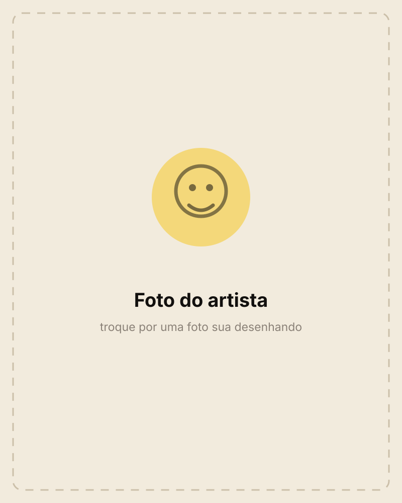

# Studio Canola — site

Site estático, sem build. O `index.html` já é o site pronto.

```
studio-canola/
├── index.html          ← a página
├── styles.css          ← visual
├── script.js           ← menu e animações
├── assets/             ← imagens (hoje são placeholders .svg)
├── robots.txt
├── .nojekyll           ← faz o GitHub Pages servir os arquivos sem processar
├── textos-webnode.md   ← textos + checklist para o site antigo
└── README.md
```

---

## 1. Ver o site agora

Clique duplo em `index.html` ou, no terminal, dentro desta pasta:

```bash
python3 -m http.server 8080
```

Depois abra http://localhost:8080

---

## 2. Publicar no GitHub Pages

O repositório já está iniciado e com o primeiro commit feito.

### 2.1 Criar o repositório no GitHub

1. Acesse https://github.com/new
2. Nome: **studio-canola** (ou o que preferir)
3. Deixe **Public** e **NÃO** marque "Add a README" (já temos um)
4. Clique em **Create repository**

### 2.2 Enviar o site

Na pasta do projeto, rode (troque `SEU-USUARIO`):

```bash
git remote add origin https://github.com/SEU-USUARIO/studio-canola.git
git push -u origin main
```

Se pedir login, use um **Personal Access Token** (github.com → Settings → Developer settings → Personal access tokens → Fine-grained tokens), não a senha.

### 2.3 Ativar o Pages

No repositório: **Settings → Pages**

- Source: **Deploy from a branch**
- Branch: **main** · pasta **/ (root)**
- **Save**

Em ~1 minuto o site fica em:

```
https://SEU-USUARIO.github.io/studio-canola/
```

---

## 3. Editar depois de publicado

### Pelo computador
Edite `index.html` / `styles.css`, depois:

```bash
git add .
git commit -m "ajusta preços"
git push
```

O Pages atualiza sozinho em ~1 minuto.

### Pelo celular (sem instalar nada)
1. Abra o repositório no navegador do celular
2. Toque em `index.html` → ícone de **lápis**
3. Faça a alteração → **Commit changes**

Pronto. Não precisa de computador nem de terminal.

---

## 4. Trocar as imagens

Hoje as imagens em `assets/` são placeholders com "Sua arte aqui".

1. Salve as fotos como `.jpg` em `assets/` (ex.: `hero.jpg`, `caricatura-01.jpg`).
2. No `index.html`, troque o `src`:
   ```html
   
   ```
   vira
   ```html
   
   ```
3. Ajuste o `alt` para descrever a foto.

**Prioridade:**
- `hero` → você desenhando ao vivo, com gente em volta (a foto que mais vende)
- `caricatura-01` a `05` → eventos reais (casamento, 15 anos, infantil, empresa)
- `caricatura-06` a `09` → digital, pet, ilustração, mascote
- `hq-01` a `03` → capas de Descobrindo Botucatu, Fabulando e Urubu Zulu
- `sobre` → um retrato seu (já preenchido com a sua caricatura)

Comprima em https://squoosh.app antes de subir (~200–400 KB por foto).

---

## 5. O que editar no HTML

| O que | Procure por |
|---|---|
| WhatsApp | `5514991203420` |
| Instagram | `instagram.com/studiocanola` |
| E-mail | `studiocanola.contato@gmail.com` |
| Preços | `R$ 200`, `R$ 300`, `R$ 400` |
| Cidade/região | `Botucatu` |
| URL do site | `https://studiocanola.com.br/` (canonical e og:url) |

---

## 6. Domínio próprio (opcional, recomendado)

1. Compre `studiocanola.com.br` no https://registro.br (~R$ 40/ano).
2. No repositório, crie um arquivo `CNAME` com uma linha:
   ```
   studiocanola.com.br
   ```
3. Settings → Pages → Custom domain → digite o domínio → Save.
4. No Registro.br, crie os registros DNS que o GitHub mostrar (CNAME para `SEU-USUARIO.github.io`).
5. Marque **Enforce HTTPS**.

---

## 7. Antes de divulgar — checklist

- [ ] Troquei os placeholders por fotos reais
- [ ] Atualizei WhatsApp, e-mail e Instagram
- [ ] Conferi os preços
- [ ] Adicionei `assets/og.jpg` (1200×630) para o link ficar bonito no WhatsApp
- [ ] Atualizei `canonical` e `og:url` com a URL final
- [ ] Testei no celular
- [ ] Testei todos os botões de WhatsApp
- [ ] Coloquei o link na bio do Instagram
- [ ] Criei o Google Meu Negócio

---

## Alternativa: Netlify

Se um dia quiser fugir do Git: https://app.netlify.com/drop → arraste esta pasta. **Crie a conta antes**, senão o site fica anônimo e você não consegue editá-lo depois.
